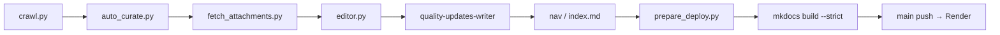

# Quality Updates

회계·감사 분야 규제 모니터링을 위한 정적 문서 사이트입니다.  
금융위원회·금융감독원·회계기준원 등 주요 기관의 보도자료, 제도 개정, 감리 결과를 시기별로 정리하여 제공합니다.

- **Agent 작업**: [AGENTS.md](AGENTS.md) — 프로젝트 점검·보완 기획 프롬프트, 작업 라우팅
- **문서 지도**: [docs/project/README.md](docs/project/README.md)

- **사이트**: [https://quality-updates.onrender.com](https://quality-updates.onrender.com)
- **빌드**: [MkDocs](https://www.mkdocs.org/) + [Material for MkDocs](https://squidfunk.github.io/mkdocs-material/)

---

## 목차

- [큐레이션 편집 도구](#큐레이션-편집-도구)
- [분기 운영 워크플로](#분기-운영-워크플로)
- [회계기준원 질의회신 아카이브](#회계기준원-질의회신-아카이브)
- [로컬 개발 환경 설정](#로컬-개발-환경-설정)
- [프로젝트 구조](#프로젝트-구조)
- [콘텐츠 업데이트 가이드](#콘텐츠-업데이트-가이드)
- [배포](#배포)
- [기여](#기여)

---

## 기능

- **규제 업데이트**: 분기별(또는 기간별) 보도자료·제도 변경 정리 (2022년~현재)
- **품질관리감리**: 금융감독원 회계법인 품질관리감리 관련 문서 요약
- **질의회신 아카이브**: 회계기준원 질의회신 원문을 `data/kasb-replies/`에 저장한다. 사이트에는 게시하지 않는다.
- **한국어 우선**: 검색·탐색·테마(라이트/다크) 한국어 지원
- **반응형**: 데스크톱·태블릿·모바일 대응
- **검색**: MkDocs Material 검색 (한국어 구분자 지원)
- **이미지 라이트박스**: glightbox 플러그인
- **HTML/CSS/JS 최소화**: minify 플러그인으로 출력 최적화
- **CI**: GitHub Actions (markdownlint, pytest, MkDocs 빌드, 콘텐츠 검증 strict)

---

## 큐레이션 편집 도구

로컬 Flask UI로 분기 `.md` 링크를 선별·출처를 연결한다. 상세는 **[docs/project/editor-curation-workflow.md](docs/project/editor-curation-workflow.md)** · **[분기 운영 작업지시서](docs/project/quarterly-operations-guide.md)** Phase 2.

```bash
python scripts/editor.py   # http://localhost:5000
```

요약은 **quality-updates-writer** 스킬 Phase 0·1.

---

## 분기 운영 워크플로

분기별 규제 업데이트 문서를 **수집 → 큐레이션 → 요약 → 사이트 반영 → 배포**까지 처리하는 표준 흐름입니다.  
**Agent(에이전트)** 와 **전문가(HITL, Human-in-the-Loop)** 의 역할·체크리스트는 **[docs/project/quarterly-operations-guide.md](docs/project/quarterly-operations-guide.md)** (분기 운영 작업지시서)를 본다.



| 단계 | 명령·도구 | 산출물 |
|------|-----------|--------|
| 1. 수집 | `python scripts/crawl.py --year YYYY --quarter N` | `docs/quality-updates/YYYY/*.md` (신규만). 금융위 보도 중 `조사·감리결과 조치`는 `제재 의결` |
| 2. 큐레이션 제안 | `python scripts/auto_curate.py <분기.md>` | 표준출력 마커 제안 (파일은 수정하지 않음) |
| 3. 첨부 수집 | `python scripts/fetch_attachments.py <분기.md>` | `downloads/` 파일, 항목별 `<!-- source: … -->`, 보고 |
| 4. 큐레이션 편집 | `python scripts/editor.py` | `<!-- skip -->`, 여러 source 마커 |
| 5. 요약 | `quality-updates-writer` 스킬 (SUMMARIZE) | 링크별 note |
| 6. 사이트 등록 | `mkdocs.yml` nav, `docs/index.md` | 사이드바·홈 최신 링크 |
| 7. 배포 전처리 | `python scripts/prepare_deploy.py` | skip 제거, validate, nav/index diff 힌트 |
| 8. 빌드·배포 | `mkdocs build --strict` → `main` push | [quality-updates.onrender.com](https://quality-updates.onrender.com) |

`fetch_attachments.py` 는 스킵(`<!-- skip -->`)과 링크만(`<!-- no_summary -->`), 이미 요약이 있는 항목은 건너뛴다. 마커가 없는 링크는 `auto_curate.py` 와 같은 규칙으로 요약 대상만 고른다. 원문 페이지의 첨부를 모두 `downloads/` 에 받고, 항목 아래에 source 마커를 한 줄에 하나씩 붙인다. 같은 문서가 HWP/HWPX 와 PDF 로 같이 있으면 PDF 만 받고 HWP 는 받지 않는다. PDF 가 없는 HWP/HWPX 만 보고의 「수동 변환 필요」에 적는다. 변환은 네이버 웨일에서 한다.

```bash
python scripts/fetch_attachments.py docs/quality-updates/2026/2026-07-01_to_2026-09-30.md
python scripts/fetch_attachments.py <분기.md> --report downloads/fetch-attachments-report.md
```

보고 기본 경로는 설정된 다운로드 폴더의 `fetch-attachments-report.md` 다. 받은 PDF, PDF가 아닌 기타 첨부, 웨일 변환이 필요한 HWP/HWPX, 다운로드 실패 항목이 나뉜다.

편집기 PDF 탭에서는 첨부를 여러 개 더하거나 뺄 수 있다. 「페이지 첨부 모두 연결」은 그 행의 원문 페이지에서 같은 규칙으로 첨부를 받아 항목에 붙인다.

금융위 보도 제목에 `조사·감리결과 조치`가 있으면 크롤이 그 링크를 `제재 의결`에 둔다. 그 문구가 없는 금융위 보도와 금감원·한공회·회계기준원 링크는 `보도자료` 등 기존 제목에 둔다. 크롤은 새 분기 파일만 만들며, 이미 있는 분기 파일은 그대로 둔다.

의사록은 보도자료 첨부가 아니다. 의결정보 게시판에 의사록 PDF가 나오면 `제재 의결`의 미공개 항목에 마커만 붙인다. 조치 표와 `위원 논의` 문장은 쓰지 않는다. `위원 논의`가 이미 채워져 있으면 의사록 마커는 건너뛴다. 제목에 `의사록(추가)`인 글은 회차 키가 같으면 같은 회의로 합치고, 합친 의사록 PDF마다 마커를 붙인다. 추가가 아닌 의사록 PDF가 같은 회의에 둘이면 마커를 붙이지 않는다.

같은 글의 안건 ZIP(첨부 2번)은 받아서 조사·감리·위탁감리·회계법인·감사인 의안의 공개용 안건과 의결서 PDF만 `downloads/sanctions/{연도}-{위원회}-{정기|임시|서면}-{N}차/`에 둔다. ZIP 원본은 남기지 않고 주소만 기록한다. 분기 문서에는 그 PDF의 source 마커를 더한다. 보도자료에 의안번호가 있으면 그 번호로 잇고, 없으면 같은 회차에서 실명 회사명이 정확히 하나일 때만 잇는다. 가려진 이름은 추정하지 않는다. 대응이 없거나 둘 이상이면 unmatched로 보고한다. HWP는 변환하지 않고 Whale 변환 필요 목록으로만 보고한다. 볼트로 보낼 때의 경로는 `raw/sanctions/`이고, `export_quarterly_raw.py`가 없는 동안에는 그 복사만 미룬다.

```bash
python scripts/attach_sanction_minutes.py <분기.md>
```

요약 스킬은 확인한 사실을 `write_quarterly_record.py`로 `data/quarterly-processed/{분기 stem}/`에 남긴다. 파일명은 `{YY-MM-DD}-{제목 앞 40자}.md`다. 같은 경로가 있으면 바이트를 유지한다. 기록 파일은 직접 고치지 않는다. `skip`, `no_summary`, Appendix 항목은 만들지 않는다. 2026년 3분기 항목은 이 명령으로 만들지 않고, 내보내기가 기존 노트에서 만든다. 같은 제목이 둘이면 `--date YY-MM-DD`를 붙인다.

```bash
python scripts/write_quarterly_record.py <분기.md> --title "<링크 제목>"
python scripts/export_quarterly_raw.py <분기.md>
```

`export_quarterly_raw.py`는 분기 마크다운, 처리 기록, PDF·캡처를 `C:\dev\obsidian-valut\raw`로 복사한다. 저장소 파일은 수정하지 않는다. `--dest`로 목적지를 바꿀 수 있다.

**npm 단축** (Node.js 설치 시):

```bash
npm run crawl              # python scripts/crawl.py (현재 분기)
npm run prepare:deploy     # 배포 전처리
npm test                   # scripts/ 테스트 (pytest)
npm run build:strict       # MkDocs strict 빌드
```

상세 절차·역할 분담·품질 게이트: [docs/project/quarterly-operations-guide.md](docs/project/quarterly-operations-guide.md) · [docs/project/README.md](docs/project/README.md) · [CONTRIBUTING.md](CONTRIBUTING.md)

---

## 회계기준원 질의회신 아카이브

회계기준원 질의회신 요약 게시판 전체를 항목 폴더로 저장한다. 분기 크롤러와 별도다. 원문은 이 사이트에 게시하지 않고, 분기 문서와 MCP 코퍼스에도 넣지 않는다. 지식화는 옵시디안 볼트의 `raw/`에서 한다.

```bash
python scripts/crawl_kasb_replies.py
python scripts/crawl_kasb_replies.py --limit 20
python scripts/crawl_kasb_replies.py --retry-failed
python scripts/export_kasb_replies_raw.py
```

`crawl_kasb_replies.py`는 `data/kasb-replies/{seq}/item.md`와 원본 첨부를 저장한다. 이 경로는 gitignore하지 않는다. `item.md`와 첨부가 이미 있으면 다시 받지 않는다. `--retry-failed`는 `failed`, `partial`, `empty`를 디스크의 원본으로 다시 추출하고, 없는 파일만 받는다.

`export_kasb_replies_raw.py`는 `item.md`만 복사한다. 기본 목적지는 `C:\dev\obsidian-vault\raw\kasb-replies`이고, `--dest`로 바꿀 수 있다. 같은 `{seq}.md`가 있으면 덮어쓰지 않는다. 첨부 파일은 복사하지 않는다.

설계: [docs/superpowers/specs/2026-11-04-kasb-reply-archive-design.md](docs/superpowers/specs/2026-11-04-kasb-reply-archive-design.md)

---

## 로컬 개발 환경 설정

### 요구사항

- **Python**: 3.8 이상
- **Node.js** (선택): `package.json` 스크립트(dev, lint) 사용 시

### 1. 저장소 복제

```bash
git clone https://github.com/ypspy/quality-updates.git
cd quality-updates
```

### 2. Python 가상환경 및 의존성

**Windows (PowerShell)**

```powershell
python -m venv .venv
.\.venv\Scripts\Activate.ps1
pip install -r requirements.txt
```

**Linux / macOS**

```bash
python3 -m venv .venv
source .venv/bin/activate
pip install -r requirements.txt
```

### 3. 로컬 서버 실행

```bash
mkdocs serve
```

(Git Bash 등에서 `mkdocs: command not found`가 나오면 `python -m mkdocs serve` 로 실행하세요.)

**alias로 고정하려면** (가상환경 활성화 후에만 동작하도록):

```bash
# 현재 셸에서만
alias mkdocs='python -m mkdocs'

# 매 터미널마다 적용: ~/.bashrc 맨 아래에 위 한 줄 추가
echo "alias mkdocs='python -m mkdocs'" >> ~/.bashrc
```

브라우저에서 [http://127.0.0.1:8000](http://127.0.0.1:8000) 로 접속합니다.

### 4. npm 스크립트 (선택)

Node.js가 설치되어 있다면:

```bash
npm install
npm run dev          # mkdocs serve (동일)
npm run build        # mkdocs build
npm run build:strict # mkdocs build --strict (경고 시 실패)
npm run lint:md      # markdownlint-cli (docs 내 .md 검사)
npm run clean        # site, .cache 등 빌드 산출물 삭제
npm run crawl        # 분기 크롤 (현재 분기)
npm run prepare:deploy  # 배포 전처리
npm test             # scripts/ pytest
```

### 5. 스크립트 (콘텐츠 작업용)

```bash
# 분기별 규제 업데이트 수집 (신규 분기만 docs/에 생성)
python scripts/crawl.py --year 2026 --quarter 1
python scripts/crawl.py   # 인자 생략 시 현재 분기

# PDF 텍스트 추출
python scripts/extract_pdf.py

# HWP 텍스트 추출 (경로 지정 또는 최근 수정 .hwp 자동 탐색)
python scripts/extract_hwp.py
python scripts/extract_hwp.py --path "경로/파일.hwp"

# 분기 문서 시계열 정렬
python scripts/reorder_chronological.py docs/quality-updates/2025/2025-01-01_to_2025-03-31.md

# 콘텐츠 검증 (admonition, YAML, 날짜 형식 등)
python scripts/validate_content.py

# 배포 전처리 (skip 제거 + validate + nav/index 힌트)
python scripts/prepare_deploy.py

# 제재 의결에 의사록·감리 안건 PDF 마커를 붙이고 unmatched를 보고
python scripts/attach_sanction_minutes.py docs/quality-updates/2026/2026-07-01_to_2026-09-30.md

# 요약에서 확인한 사실을 처리 기록으로 저장 (분기 파일은 수정하지 않음)
python scripts/write_quarterly_record.py <분기.md> --title "<링크 제목>"

# 분기 원문·처리 기록·PDF를 옵시디안 raw로 복사
python scripts/export_quarterly_raw.py <분기.md>
```

### 6. 엄격 빌드 검증

배포 전 로컬에서 다음을 권장합니다.

```bash
# 가상환경 활성화 상태에서
mkdocs build --strict
```

경고가 있으면 빌드가 실패하므로, 링크·설정·문서 오류를 먼저 수정해야 합니다.

---

## 프로젝트 구조

```
quality-updates/
├── docs/                          # 문서 소스 (MkDocs 소스 루트)
│   ├── project/                   # 메타·운영 문서 (MkDocs exclude)
│   │   ├── README.md              # 문서 지도
│   │   ├── quarterly-operations-guide.md
│   │   └── editor-curation-workflow.md
│   ├── superpowers/               # 설계 spec·plan 아카이브 (MkDocs exclude)
│   ├── index.md                   # 홈페이지
│   ├── assets/
│   │   ├── images/                # 이미지 (로고 등)
│   │   ├── icons/
│   │   ├── stylesheets/extra.css  # 추가 CSS
│   │   └── javascripts/extra.js   # 추가 JS
│   ├── quality-updates/           # 규제 업데이트
│   │   ├── index.md               # 규제 업데이트 개요
│   │   ├── 2022/
│   │   ├── 2023/
│   │   ├── 2024/
│   │   └── 2025/
│   └── fss-review/                # 품질관리감리
│       ├── index.md
│       └── fr2022.md
├── overrides/
│   └── partials/                  # Material 테마 오버라이드
│       ├── header.html
│       └── footer.html
├── mkdocs.yml                     # MkDocs 설정
├── requirements.txt               # Python 의존성 (버전 고정)
├── package.json                   # npm 스크립트 및 devDependencies
├── .editorconfig                  # 에디터 포맷 규칙
├── .markdownlint.json             # Markdown 린트 설정
├── .github/
│   ├── workflows/ci.yml           # CI (lint, build, validate)
│   └── dependabot.yml             # 의존성 자동 업데이트
├── data/
│   ├── kasb-replies/              # 질의회신 원문 아카이브 (사이트 비게시)
│   └── quarterly-processed/       # 요약 처리 기록 (사이트 빌드 제외)
├── scripts/                       # 유틸리티 스크립트
│   ├── crawl.py                   # 규제 업데이트 크롤러 CLI
│   ├── crawl_kasb_replies.py      # 질의회신 수집 CLI
│   ├── export_kasb_replies_raw.py # item.md만 옵시디안 raw로 복사
│   ├── crawler/                   # FSS·FSC·KICPA·KASB 수집 모듈
│   ├── editor.py                  # 큐레이션 편집기 진입점 (Flask)
│   ├── editor/                    # 편집기 앱·정적 파일
│   ├── fetch_attachments.py       # 요약 대상 원문 첨부 일괄 다운로드
│   ├── attach_sanction_minutes.py # 제재 의결에 의사록 PDF 마커
│   ├── write_quarterly_record.py  # 처리 기록 생성·추가
│   ├── export_quarterly_raw.py    # 분기 원문을 옵시디안 raw로 복사
│   ├── extract_pdf.py             # PDF 텍스트 추출
│   ├── extract_hwp.py             # HWP 텍스트 추출
│   ├── reorder_chronological.py   # 콘텐츠 시계열 정렬
│   ├── validate_content.py        # 콘텐츠 스키마 검증
│   ├── prepare_deploy.py          # 배포 전처리 (skip·validate·힌트)
│   └── tests/                     # 스크립트 단위 테스트
├── .claude/skills/quality-updates-writer/  # 분기 요약·배포 정리 스킬
├── AGENTS.md                        # Agent 진입·보완 기획 프롬프트
├── README.md                      # 이 파일
├── CONTRIBUTING.md                # 기여 가이드
└── IMPLEMENTATION_LOG.md          # 개선 작업 실행 로그
```

- **탐색 구조**: `mkdocs.yml`의 `nav`에서 메뉴·레이블·파일 매핑을 정의합니다.
- **스타일/스크립트**: `docs/assets/` 아래 파일은 `mkdocs.yml`의 `extra_css`, `extra_javascript`로 로드됩니다.

---

## 콘텐츠 업데이트 가이드

### 분기별 규제 업데이트 문서

새 기간 문서를 추가할 때는 아래 YAML 프론트매터 템플릿을 사용하세요.  
파일명은 `YYYY-MM-DD_to_YYYY-MM-DD.md` 형태를 권장합니다 (예: `2025-01-01_to_2025-03-31.md`).

**프론트매터 템플릿**

```yaml
---
title: YYYY-MM-DD ~ YYYY-MM-DD 규제 업데이트
description: [기간] 회계·감사 분야 규제 변화 및 주요 이슈 정리
jurisdiction: KR
year: YYYY
frequency: quarterly
period_label: YYYY-QX
period:
  start: YYYY-MM-DD
  end: YYYY-MM-DD
category: Quality Updates
agencies: [FSS, FSC, KICPA, KASB]
tags: [규제 업데이트, 회계기준, 감사감리, 금융감독]
---
```

- **title**: 페이지 제목 (탐색·검색에 사용)
- **description**: 요약 설명 (SEO·검색 결과용)
- **jurisdiction**: 관할 (한국: KR)
- **year**, **period_label**, **period**: 기간 정보
- **agencies**: 언급 기관 (FSS, FSC, KICPA, KASB 등)
- **tags**: 검색·필터용 태그

문서 본문은 기존 분기별 파일과 동일한 형식(금융감독원, 보도자료 등 섹션)을 따르면 됩니다.  
추가 후 **반드시 `mkdocs.yml`의 `nav`에 새 페이지를 등록**해야 사이드바/탭에 표시됩니다.

**전체 분기 운영 흐름·Agent/HITL 역할**: [분기 운영 워크플로](#분기-운영-워크플로) · [docs/project/quarterly-operations-guide.md](docs/project/quarterly-operations-guide.md) · [AGENTS.md](AGENTS.md)

### 품질관리감리·기타 문서

- 새 문서에도 `title`, `description` 등 최소 프론트매터를 두는 것을 권장합니다.
- 이미지 추가 시 `CONTRIBUTING.md`의 이미지·alt 텍스트 가이드라인을 참고하세요.

자세한 워크플로우·커밋 규칙·테스트 체크리스트는 **[CONTRIBUTING.md](CONTRIBUTING.md)** 를 참조하세요.

---

## MCP 코퍼스 (다른 Agent)

사람은 [공개 사이트](https://quality-updates.onrender.com)에서 조회한다. 다른 Agent는 같은 공개 경계의 **읽기 전용 MCP**에 붙는다. 문헌 검색 MCP와 역할이 다르다: 이 코퍼스는 한국 감독·기준(FSS, FSC, KICPA, KASB) **큐레이션 사실**만 제공한다.

Tool: `list_quarterly_periods`, `search_regulatory_updates`, `get_regulatory_update`.

**인용 계약**

1. 주장마다 `agency`, `date`, `title`, `url` (가능하면 `id`)를 붙인다.
2. note bullets·표에 있는 내용만 쓴다. 없는 숫자·해석은 창작이다.
3. `summary_status=no_summary`면 제목·URL만 힌트이고, 본문 사실로 쓰지 않는다.
4. skip 항목은 코퍼스에 없다. 사이트 원문 md에서 되살리지 않는다.
5. 코퍼스는 읽기 전용이다. 큐레이션·요약·nav는 생산 레인만 한다.

```bash
# 코퍼스 생성 (skip 제외, Appendix A 이전만)
python scripts/export_corpus.py --strict

# 로컬 stdio MCP (Cursor). 워크스페이스 절대경로가 든 .cursor/mcp.json은 커밋하지 않는다.
# .cursor/mcp.json 예시:
# { "mcpServers": { "quality-updates": {
#     "command": "python", "args": ["scripts/mcp_server/stdio.py"],
#     "cwd": "/path/to/quality-updates" } } }
python scripts/mcp_server/stdio.py

# Hosted HTTP (Render 2번째 Web Service — 사이트와 별도)
# cwd=scripts, PYTHONPATH=scripts, env MCP_API_KEY 필수
# Start: uvicorn mcp_server.http:app --host 0.0.0.0 --port $PORT
# Health: GET /health
# MCP: POST /mcp  Authorization: Bearer <MCP_API_KEY>
# Host 허용: RENDER_EXTERNAL_HOSTNAME(Render 주입) + 선택 MCP_ALLOWED_HOSTS
# 실제 호스트 URL은 HITL이 Render에서 만든 뒤 이 절에 적는다.
```

설계: [docs/superpowers/specs/2026-06-27-mcp-corpus-design.md](docs/superpowers/specs/2026-06-27-mcp-corpus-design.md) · [소비 제품 spec](docs/superpowers/specs/2026-09-10-consumption-mcp-product-design.md)

---

## 배포

- **플랫폼**: [Render](https://render.com)
- **동작**: `main` 브랜치 푸시 시 자동 빌드·배포
- **빌드 명령**: `pip install -r requirements.txt && mkdocs build`
- **출력 디렉터리**: `site/`
- **사이트 URL**: [https://quality-updates.onrender.com](https://quality-updates.onrender.com)

Render 대시보드에서 환경 변수·브랜치·빌드 명령을 변경할 수 있습니다.  
로컬에서는 `mkdocs build --strict`로 동일한 빌드 결과를 검증할 수 있습니다.

---

## 기여

버그 제보, 문서 수정, 개선 제안은 이슈와 Pull Request로 환영합니다.  
진행 절차와 스타일 가이드는 **[CONTRIBUTING.md](CONTRIBUTING.md)** 에 정리되어 있습니다.

---

## 라이선스·저작권

© 2026 Quality Updates.  
사이트 내 저작권 문구는 `mkdocs.yml`의 `copyright` 및 푸터 오버라이드에 정의되어 있습니다.
