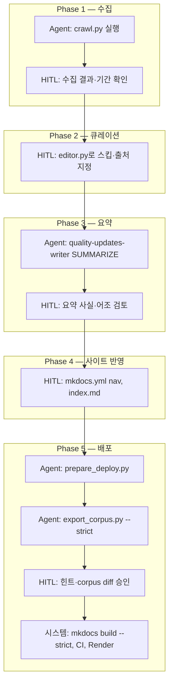

# 분기 운영 작업지시서

**대상**: Quality Updates 분기별 규제 업데이트 문서 운영  
**버전**: 2026-11  
**관련 문서**: [README.md](../../README.md), [CONTRIBUTING.md](../../CONTRIBUTING.md), [editor-curation-workflow.md](editor-curation-workflow.md), [quality-updates-writer 스킬](../../.claude/skills/quality-updates-writer/SKILL.md)

---

## 1. 목적

금융당국(FSS, FSC, KICPA, KASB) 보도자료·공지를 분기 단위로 수집하고, 전문가 판단으로 선별·요약한 뒤 공개 사이트에 반영한다.

본 문서는 **단계별 작업**, **Agent(에이전트)와 전문가(HITL)의 역할**, **품질 게이트**를 정의한다.

---

## 2. 역할 정의

| 역할 | 담당 | 책임 |
|------|------|------|
| **Agent** | Cursor·Claude 등 AI 에이전트 | 반복·대량 처리: 크롤 실행, 스킬 기반 요약 초안, validate/build, diff 힌트 해석 보조 |
| **전문가 (HITL)** | 회계·감사 실무 담당자 | 전문 판단: 링크 선별·스킵, 출처 적합성, 요약 사실 검증, 배포 승인 |
| **시스템** | 스크립트·CI | 규칙 기계 검증: 포맷, markdownlint, pytest, MkDocs strict, skip 쌍 제거 |

**원칙**

- Agent는 **원문에서 확인된 내용만** 요약한다 (스킬 RIGID 규칙). 추정·보완 금지.
- HITL은 Agent 산출물을 **그대로 배포하지 않는다**. 큐레이션·요약·nav/index는 반드시 검토한다.
- `mkdocs.yml`·`docs/index.md`·사이트 구조는 **HITL이 diff 힌트를 검토 후 수동 적용**한다 (자동 패치 없음).
- 분기 규제 업데이트·제재 의결·질의회신 파이프라인은 Agent와 전문가가 협업한다. 기능 구현·품질관리감리와는 일을 나눈다.
- 제재 의결의 조사·감리·위탁감리·회계법인·감사인 의안은 품질관리감리(`docs/fss-review/`)와 별도이다.
- validate/build·markdownlint는 이 파이프라인과 품질관리감리 PR에서 같이 돌린다.
- 품질관리감리 결과 보도가 분기 규제 문서에 들어갈 때는 서로 알린다.
- 파이프라인은 볼트에 직접 쓰지 않는다.
- 질의회신 seq는 질의회신 식별자이다. 수집 PR이 머지된 뒤 새 seq 목록과 요약을 넘긴다. `data/kasb-replies/{seq}/item.md`를 볼트 `raw/kasb-replies/{seq}.md`로 넣되, 있는 파일은 유지하고 첨부는 저장소에 둔다.
- 제재는 회차이다. `downloads/sanctions/{회차}/`에 `record.md`와 의사록 PDF가 생기면 경로와 회차 목록을 넘긴다.
- `export_kasb_replies_raw.py`와 `export_quarterly_raw.py`는 복사 도구이다.

---

## 3. 전체 흐름



---

## 4. 단계별 작업지시

### Phase 1 — 수집 (Crawl)

| | Agent | HITL | 시스템 |
|---|-------|------|--------|
| **실행** | `python scripts/crawl.py --year YYYY --quarter N` | 대상 연도·분기 지정, `--dry-run` 결과 확인 | 파일 없을 때만 생성 (기존 큐레이션본 보호) |
| **산출** | `docs/quality-updates/YYYY/YYYY-MM-DD_to_YYYY-MM-DD.md` | — | YAML front matter, 4기관 링크, Appendix A |
| **정렬** | 본문 dated list는 **과거→현재** (`unified.py`) | — | Appendix A는 크롤 수집 순(최신→과거) **유지** |
| **검토** | — | 기간·건수 이상 여부, 누락 기관 없는지 샘플 확인 | — |

`조사·감리결과 조치`가 없는 금융위 보도와 금감원·한공회·회계기준원 링크는 `보도자료` 등 기존 제목에 둔다.

**Agent 체크리스트**

- [ ] 올바른 `--year` / `--quarter` (또는 `--start` / `--end`)
- [ ] `[WARN] Output exists, skipping` 시 기존 파일 의도 확인
- [ ] `[DONE]` 경로가 `docs/quality-updates/{연도}/` 인지 확인
- [ ] 본문 첫·마지막 링크 날짜가 분기 시작·종료 방향과 맞는지 (과거→현재)

**HITL 체크리스트**

- [ ] 분기 기간이 달력 분기와 일치하는지
- [ ] 본문에 Executive Summary **없음**이 정상 (아직 수집 단계)
- [ ] Appendix A에 원자료가 포함되었는지

---

### Phase 2 — 큐레이션 (Editor)

| | Agent | HITL | 시스템 |
|---|-------|------|--------|
| **실행** | — | `python scripts/editor.py` | Flask 로컬 UI |
| **판단** | — | 링크별 **스킵** / **요약 필요** / **완료** | 마커를 `.md`에 저장 |
| **출처** | — | PDF·WEB·CLIP·KASB 첨부 연결 | `downloads/` 저장 |

**첨부**

- `fetch_attachments.py`는 skip(`<!-- skip -->`), 링크만(`<!-- no_summary -->`), 이미 요약이 있는 항목을 건너뛴다.
- 마커가 없는 링크는 `auto_curate.py`와 같은 규칙으로 고른다.
- 같은 문서가 HWP/HWPX와 PDF로 같이 있으면 PDF만 받는다.
- PDF가 없는 HWP/HWPX만 보고의 「수동 변환 필요」에 적는다.
- 보고 기본 경로는 설정된 다운로드 폴더의 `fetch-attachments-report.md`다. 받은 PDF, PDF가 아닌 기타 첨부, 웨일 변환이 필요한 HWP/HWPX, 다운로드 실패 항목이 나뉜다.
- 편집기 PDF 탭에서는 첨부를 여러 개 더하거나 뺄 수 있다. 「페이지 첨부 모두 연결」은 그 행의 원문 페이지에서 같은 규칙으로 첨부를 받아 항목에 붙인다.

**HITL 전용** — 이 단계는 전문가 판단이 핵심이다.

- [ ] 회계·감사 관련성 없는 보도자료 → **스킵**
- [ ] 요약 대상 → **요약 필요** + 원문(PDF/WEB) 연결
- [ ] 이미 요약된 링크 → **완료** 유지
- [ ] 저장 후 에디터가 `line_index` 갱신됐는지 확인 (연속 저장 시 오적용 방지)

**Agent**

- 이 단계에서 Agent가 `.md`의 스킵·출처를 **임의로 대량 변경하지 않는다**.
- 사전 제안이 필요하면 `python scripts/auto_curate.py <분기.md>` 로 마커 후보만 출력한다. 콘텐츠에 써 넣지 않는다. 규칙: [curation-rules.md](curation-rules.md).
- HITL이 지정한 `<!-- source: … -->`만 Phase 3 입력으로 사용한다.

상세 UI·마커 규칙: [editor-curation-workflow.md](editor-curation-workflow.md)

---

### Phase 3 — 요약 (Writer 스킬)

| | Agent | HITL | 시스템 |
|---|-------|------|--------|
| **실행** | `quality-updates-writer` — **SUMMARIZE** (gold-excerpts + md ±80줄 윈도우 + REFERENCE 온디맨드; 재주입 금지) | 요약 대상 링크·우선순위 지시 | 스킬 포맷·gold-excerpts |
| **Phase 0** | PDF/WEB/CLIP 경로 결정 | 출처 파일 존재·적합성 확인 | `extract_pdf.py` 등 |
| **Phase 1** | 링크별 `!!! note` 요약 | **사실 관계 최종 검증** | — |

PDF가 없는 HWP/HWPX는 `fetch_attachments.py` 보고의 변환 목록이다. Agent가 네이버 웨일 뷰어 인쇄로 PDF를 저장하고 `pdf` 마커로 연결한다. 저장소 스크립트는 웨일을 실행하지 않는다. 조사·감리결과 조치는 금융위원회 `제재 의결`에 둔다. 의사록은 회의 뒤 약 8주 뒤에 공개되므로, 크롤 당일에는 아래 두 단계를 실행하지 않는다. 의사록이 공개된 분기 파일에서 실행한다. 최종 모양은 2026년 3분기 `제재 의결`과 같다.

1. `python scripts/attach_sanction_minutes.py <분기.md>`  
   실명과 의안번호가 하나와만 맞는 의안만 보도 항목에 붙인다. 가려진 이름은 추정하지 않는다. `분기중 미보도 항목`은 만들지도 지우지도 않는다. `위원 논의`가 이미 있으면 의사록 마커는 건너뛴다.
2. `quality-updates-writer` 요약  
   그 분기 파일에 나온 회의의 `downloads/sanctions/.../record.md`에서 연결이 `unmatched`인 PDF만 읽는다. 지적과 금액이 같은 회의 보도 한 건과만 맞으면 그 보도 항목에 출처를 붙인다. 기호가 비슷하다는 이유로는 붙이지 않는다. 맞는 보도가 없거나 둘 이상이면 아래 미보도 불릿에 둔다. 실명인데 회사명 칸에 없어 스크립트가 놓친 파일도 여기서 읽는다.

보도 항목은 조치 표 아래에 `!!! info "안건 분석"`, 그 다음에 `!!! note "위원 논의"`를 둔다. 안건 분석에는 의안 번호, 지적, 조치안, 보도 표의 어느 행과 맞는지를 적는다. 위원 질의와 의결은 위원 논의에 둔다. 두 상자를 한 노트로 합치지 않는다. 표의 회사명과 금액은 고치지 않는다. 의사록을 읽지 않았으면 위원 논의는 `미공개` 한 줄만 둔다.

미연결 의안은 `제재 의결` 맨 끝에 헤더 없이 `- 분기중 미보도 항목` 불릿 하나로 둔다. 다음 절은 `#### 고시/공고/훈령`이다. 불릿 안에는 안건마다 `!!! info "안건 분석"`을 회의일, 의안번호 순으로 둔다. 안건과 제목은 한 줄이다. 이어서 요약, 의결정보다. 요약은 두 문장을 넘기지 않는다. PDF 출처 주석은 그 불릿에 둔다. 같은 의안번호의 안건과 의결서는 한 상자다. 번호가 없는 보고는 파일마다 한 상자다. 미보도 상자에는 조치 표와 `위원 논의`를 만들지 않는다. 다시 요약할 때 안건 분석, 위원 논의, `분기중 미보도 항목`은 지우지 않는다. `record.md`는 고치지 않는다. PDF를 읽을 수 없으면 제목만 쓰고 출처 마커는 쓰지 않는다.

`validate_content.py --strict`는 `record.md`가 있는 회의만 본다. unmatched 경로가 분기 문서 안에 있는지만 확인한다. 보도 항목에 있어도, 미보도 불릿에 있어도 통과한다. 기록이 없으면 그 회의는 건너뛴다.

제목에 `의사록(추가)`인 글은 회차 키가 같으면 같은 회의로 합치고, 합친 의사록 PDF마다 마커를 붙인다. 추가가 아닌 의사록 PDF가 같은 회의에 둘이면 마커를 붙이지 않는다.

같은 글의 안건 ZIP(첨부 2번)은 받아서 조사·감리·위탁감리·회계법인·감사인 의안의 공개용 안건과 의결서 PDF만 `downloads/sanctions/{연도}-{위원회}-{정기|임시|서면}-{N}차/`에 둔다. `조사`만 있는 파일은 남기지 않고, `조사·감리` 또는 `조사결과`일 때만 본다. `불공정거래`, `시세조종`, `미공개정보`가 들어간 파일과 규정·개정 안건은 남기지 않는다. ZIP 원본은 남기지 않고 주소만 기록한다. 회차 폴더에는 의사록 PDF를 복사하고 `record.md`에 회의일을 적는다. 보도자료에 의안번호가 있으면 그 번호로 잇고, 없으면 같은 회차에서 실명 회사명이 정확히 하나일 때만 잇는다.

제재 안건 HWP는 변환하지 않고 Whale 변환 필요 목록으로만 보고한다.

요약 스킬은 확인한 사실을 `write_quarterly_record.py`로 `data/quarterly-processed/{분기 stem}/`에 남긴다. 파일명은 `{YY-MM-DD}-{제목 앞 40자}.md`다. 같은 경로가 있으면 바이트를 유지한다. 기록 파일은 직접 고치지 않는다. `skip`, `no_summary`, Appendix 항목은 만들지 않는다. 2026년 3분기 항목은 이 명령으로 만들지 않고, 내보내기가 기존 노트에서 만든다. 같은 제목이 둘이면 `--date YY-MM-DD`를 붙인다.

`export_quarterly_raw.py`는 분기 마크다운, 처리 기록, PDF·캡처를 `C:\dev\obsidian-valut\raw`로 복사한다. 저장소 파일은 수정하지 않는다. `--dest`로 목적지를 바꿀 수 있다.

볼트로 보낼 때의 경로는 `raw/sanctions/`이고, 그 복사는 `export_quarterly_raw.py`에 들어가기 전까지 미룬다.

**Agent 체크리스트** (스킬 준수)

- [ ] `reference/gold-excerpts.md` 세션 1회 Read; 분기 md ±80줄 윈도우; REFERENCE 온디맨드; 재주입 금지
- [ ] 원문 미확인 내용 미포함
- [ ] 접근 불가 시 `<!-- 원문 접근 불가 -->` 처리
- [ ] 의사록 공개 뒤 `attach_sanction_minutes.py`를 실행하고, unmatched는 보도 항목 또는 `분기중 미보도 항목`에 둠
- [ ] 보도 항목은 조치 표, 안건 분석, 위원 논의 순. 표의 회사명과 금액은 유지
- [ ] 미보도 상자는 안건·제목 한 줄, 요약 두 문장 이내, 의결정보. 조치 표와 위원 논의는 없음

**HITL 체크리스트**

- [ ] 제재·수치·제도명 등 **핵심 사실** 샘플링 대조
- [ ] 과도한 해석·일반론 없음

---

### Phase 4 — 사이트 반영 (Nav / Index)

| | Agent | HITL | 시스템 |
|---|-------|------|--------|
| **실행** | diff 힌트 해석 보조 | `mkdocs.yml` nav 수동 추가 | — |
| **대상** | — | `docs/index.md` Latest Update 링크 | — |

**HITL 체크리스트**

- [ ] `mkdocs.yml` → 규제 업데이트 → 해당 연도 → `N분기 (MM–MM월): quality-updates/...`
- [ ] `docs/index.md` 바로가기·Latest Update가 새 분기를 가리킴
- [ ] 로컬 `mkdocs serve`로 사이드바·링크 확인

**Agent**

- nav/index **자동 커밋하지 않음**. HITL 승인 후에만 반영.

---

### Phase 5 — 배포 전처리·배포

| | Agent | HITL | 시스템 |
|---|-------|------|--------|
| **실행** | `python scripts/prepare_deploy.py` | stdout diff 힌트 검토·적용 | skip 제거, validate `--strict` |
| **코퍼스** | `python scripts/export_corpus.py --strict` | `data/corpus/` JSONL·manifest 커밋 여부 검토 | skip in-memory 제외 |
| **선행** | `prepare_deploy.py --dry-run` 권장 | 삭제될 skip 쌍 확인 | — |
| **빌드** | `mkdocs build --strict` | 최종 미리보기 | CI 동일 |
| **배포** | — | `main` merge·push **승인** | Render 자동 배포 |

**Agent 체크리스트**

- [ ] `prepare_deploy` exit 0
- [ ] validate strict 통과
- [ ] `python scripts/export_corpus.py --strict` 통과
- [ ] `npm test` 또는 `cd scripts && python -m pytest tests/ -q` 통과
- [ ] `docs/` Markdown을 수정했으면 `npm run lint:md` 통과

**HITL 체크리스트**

- [ ] Appendix A 보존 (skip 제거 대상 아님)
- [ ] 공개 본문에 스킵 링크·마커 잔존 없음
- [ ] corpus JSONL을 사이트와 같이 커밋할지 결정 (MCP Hosted는 커밋된 JSONL을 읽음)
- [ ] 배포 후 [quality-updates.onrender.com](https://quality-updates.onrender.com) 샘플 확인

---

## 5. 역할 분담 요약표

| 단계 | Agent | HITL | 자동(스크립트/CI) |
|------|:-----:|:----:|:-----------------:|
| 1. 수집 | 실행·로그 보고 | 기간·건수 승인 | skip-if-exists |
| 2. 큐레이션 | — | **주도** | 마커 저장 |
| 3. 요약 | **주도**(스킬) | **검증·승인** | 포맷 규칙 |
| 4. nav/index | 힌트 보조 | **주도** | — |
| 5. 배포 전처리 | 실행 | 힌트·diff 승인 | skip 제거, validate |
| 6. 배포 | build·test 실행 | **push 승인** | CI, Render |

---

## 6. 명령어 빠른 참조

```bash
# 수집
python scripts/crawl.py --year 2026 --quarter 2
python scripts/crawl.py --dry-run

# 큐레이션
python scripts/editor.py

# 배포 전처리
python scripts/prepare_deploy.py --dry-run
python scripts/prepare_deploy.py

# 검증
python scripts/validate_content.py --strict
python scripts/export_corpus.py --strict
cd scripts && python -m pytest tests/ -q
mkdocs build --strict
npm run lint:md

# 첨부
python scripts/fetch_attachments.py docs/quality-updates/2026/2026-07-01_to_2026-09-30.md
python scripts/fetch_attachments.py <분기.md> --report downloads/fetch-attachments-report.md

# 제재 의결 의사록·처리 기록·raw 복사
python scripts/attach_sanction_minutes.py <분기.md>
python scripts/write_quarterly_record.py <분기.md> --title "<링크 제목>"
python scripts/export_quarterly_raw.py <분기.md>

# 질의회신. 분기 크롤러와 별도다. 원문은 사이트, 분기 문서, MCP 코퍼스에 넣지 않는다.
python scripts/crawl_kasb_replies.py
python scripts/crawl_kasb_replies.py --limit 20
python scripts/crawl_kasb_replies.py --retry-failed
python scripts/export_kasb_replies_raw.py

# 텍스트 추출·정렬
python scripts/extract_pdf.py
python scripts/extract_hwp.py
python scripts/extract_hwp.py --path "경로/파일.hwp"
python scripts/reorder_chronological.py docs/quality-updates/2025/2025-01-01_to_2025-03-31.md
```

`crawl_kasb_replies.py`는 `data/kasb-replies/{seq}/item.md`와 원본 첨부를 저장한다. 이 경로는 gitignore하지 않는다. `item.md`와 첨부가 이미 있으면 다시 받지 않는다. `--retry-failed`는 `failed`, `partial`, `empty`를 디스크의 원본으로 다시 추출하고, 없는 파일만 받는다.

`export_kasb_replies_raw.py`는 `item.md`만 복사한다. 기본 목적지는 `C:\dev\obsidian-vault\raw\kasb-replies`이고, `--dest`로 바꿀 수 있다. 같은 `{seq}.md`가 있으면 덮어쓰지 않는다. 첨부 파일은 복사하지 않는다.

npm: `npm run crawl`, `npm run prepare:deploy`, `npm test`, `npm run build:strict`, `npm run lint:md`

---

## 7. 품질 게이트 (배포 전 필수)

| # | 게이트 | 담당 |
|---|--------|------|
| G1 | HITL 큐레이션 완료 (요약 필요 링크에 source 연결) | HITL |
| G2 | HITL 요약 사실 검토 완료 | HITL |
| G3 | `mkdocs.yml` nav 등록 | HITL |
| G4 | `prepare_deploy.py` 성공 | Agent 실행, HITL 확인 |
| G5 | `validate_content --strict` 통과 | 시스템 |
| G6 | `pytest` 통과 | 시스템 |
| G6b | `npm run lint:md` 통과. 실패 시 [CONTRIBUTING.md](../../CONTRIBUTING.md)의 Markdown lint 절차로 고치고 재실행 | Agent |
| G7 | `mkdocs build --strict` 통과 | Agent/HITL |
| G7b | `export_corpus.py --strict` 통과 | 시스템 |
| G8 | `main` push 승인 | HITL |

**G1~G3 미충족 시 배포 금지.**

---

## 8. 예외·에스컬레이션

| 상황 | 처리 |
|------|------|
| 크롤러 기관별 수집 실패 | Agent 재실행; 지속 실패 시 HITL이 해당 기관 수동 보완 |
| 원문(PDF/HWP) 접근 불가 | Agent: OCR fallback → 실패 시 HITL이 수동 확보 |
| Agent 요약과 원문 불일치 | HITL이 수정 지시 후 Agent 재작성 |
| validate strict 실패 | Agent가 포맷 수정; 내용 변경 없이 들여쓰기·날짜 형식만 |
| `npm run lint:md` 실패 | Agent가 보고된 줄만 수정하고 재실행. 규칙 비활성화, 파일 제외, 줄 끝 공백 일괄 삭제는 하지 않음 |
| nav 힌트와 실제 레이블 불일치 | HITL이 기존 nav 관례에 맞게 수동 조정 |

---

## 9. 관련 파일

| 경로 | 용도 |
|------|------|
| `scripts/crawl.py` | 분기 수집 CLI |
| `scripts/editor.py` | 큐레이션 UI |
| `.claude/skills/quality-updates-writer/SKILL.md` | 요약·스킵 제거 규칙 |
| `scripts/prepare_deploy.py` | 배포 전처리 |
| `scripts/validate_content.py` | 콘텐츠 스키마 검증 |
| `scripts/export_corpus.py` | MCP 코퍼스 JSONL (skip 제외) |
| `scripts/mcp_server/` | 읽기 전용 MCP (stdio + HTTP) |
| `mkdocs.yml` | 사이트 탐색 |
| `docs/quality-updates/` | 분기 문서 소스 |

---

## 10. 개정 이력

| 날짜 | 내용 |
|------|------|
| 2026-11-07 | README에만 있던 첨부·제재 의결·질의회신·추출 명령을 해당 Phase와 6절로 옮김 |
| 2026-09-10 | Phase 5에 corpus export. 소비는 사이트+MCP. 렌즈 스킬 제거 |
| 2026-06-25 | 초판 — 크롤러 통합·prepare_deploy 반영, Agent/HITL 역할 분담 |
